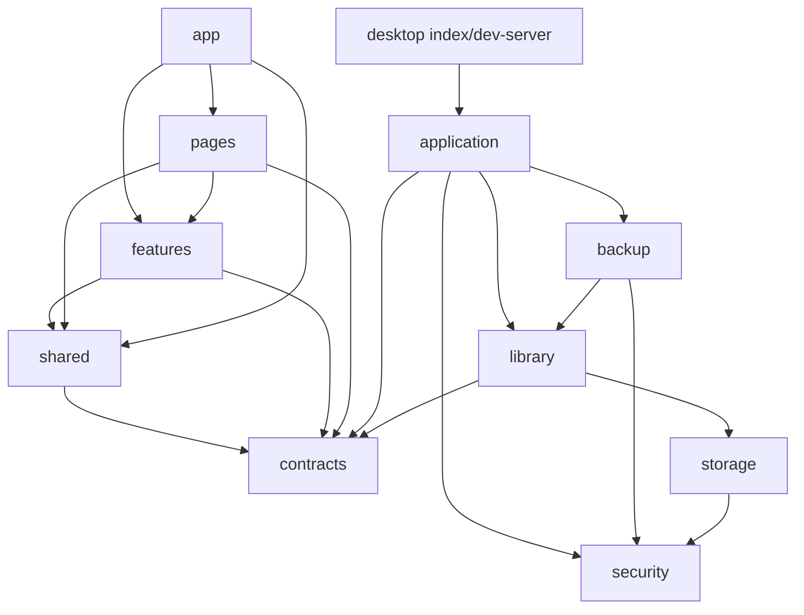

# 코드 구조와 모듈 경계

## 모노레포 판단

현재는 **단일 패키지의 모듈형 앱**을 유지한다. React 화면과 Bun 메인 프로세스는 서로 다른 실행 환경이지만,
하나의 Electrobun 앱으로 같은 버전에서 빌드·배포된다. 독립적으로 배포하는 다른 앱이나 재사용 패키지가 없으므로,
현재 단계에서 pnpm workspace와 여러 package.json을 도입하면 설치·빌드·버전 관리만 늘어난다.

먼저 코드 의존 관계를 분리하고 검사한다. 이후 실제로 별도 웹/모바일 앱이 생기거나, 여러 제품이 같은 도서 모델을
사용하거나, 독립 배포하는 AI 작업 서비스가 생기면 `apps/`와 `packages/`로 분리할지 다시 검토한다.
향후 ISBN·AI 자동 입력도 우선 독립 기능과 데스크탑 작업 모듈로 추가할 수 있다. 이번 변경에는 AI 기능을 추가하지 않았다.

## 디렉터리별 책임

```text
contracts/                    화면과 메인 프로세스의 공통 데이터·요청 타입
  book.ts                     도서, 필터, 정렬, 입력 타입
  desktop.ts                  명령별 입력/결과, 잠금·백업 타입, RPC 구조
  calendar-date.ts            두 런타임에서 사용하는 달력 날짜 검증
src/
  app/                        실행 진입점, 전역 Provider, 라우팅, 앱 셸, 스타일
  pages/
    library/                  서재 화면, 화면 전용 상태 훅, 표
    settings/                 잠금·저장소·백업 기능 조합과 캐시 정리
    statistics/               통계 화면
    not-found/                없는 경로 처리
  features/
    books/
      components/             도서 카드·상세·폼·필터·가상 목록·통계
      hooks/                  도서 조회/변경과 주제 색상 훅
      api/                    쿼리 키와 도서 캐시 관리
      model/                  폼 검증, 도서 상수, 주제 색상 규칙
      index.ts                다른 계층에 제공하는 공개 API
    lock/
      components/             잠금 Provider/화면과 PIN 설정
      index.ts
    data-management/
      components/             백업 폼, 복원/초기화 확인창
      hooks/                  비밀번호·미리보기·처리 상태와 명령 실행
      index.ts
  shared/
    api/                      화면의 유일한 Electrobun/개발 브리지 연결
    ui/                       도서와 무관한 공용 UI
    notifications/            토스트 컴포넌트·훅·상태
    hooks/                    공용 훅
    lib/                      범용 포맷·오류·로컬 UI 설정
    config/                   공통 경로 상수
    assets/fonts/             번들 글꼴과 라이선스
    theme/                    CSS 디자인 토큰·기본 스타일·모션·범주 색상 참조
  test/                       테스트 Provider와 가상 도서 fixture
  vite-env.d.ts               렌더러 환경 타입

desktop/
  index.ts                    네이티브 실행 구성, RPC와 창 수명
  dev-server.ts               브라우저 개발 전용 루프백 브리지
  application/                요청 직렬화·검증·분배, 저장소 초기화
  library/                    도서 저장 스키마 검증, 조회·변경 SQL, 암호화 표지 파일 관리
  backup/                     비밀번호 암호화 백업, 미리보기·복원 수명
  security/                   PIN 검증/지연, OS 키 저장소, AES-GCM
  storage/                    SQLite 연결·스키마·트랜잭션, 암호화 저장, 파일/프로세스 잠금
  platform/                   Electrobun 메뉴·OS 내보내기 대화상자
  tests/                      데이터 보존·암호화·백업 통합 테스트
tooling/
  config/                     Vite, Vitest, Playwright, Tailwind 설정
  scripts/                    개발 서버, 빌드 런타임 보완, 구조 검사
  storybook/                  Storybook 실행 설정
  tsconfig.json               개발 설정과 E2E 코드의 타입 검사
docs/storybook/              컴포넌트 문서의 진입 페이지
tests/e2e/                   실제 저장소를 연결한 사용자 흐름 검증
build/                       모든 생성물 (Git 제외)
  renderer/                   Vite 렌더러 번들
  desktop/                    Electrobun 앱
  releases/                   stable 설치·업데이트 파일
  storybook/                  정적 컴포넌트 문서
  reports/                    E2E 결과·스크린샷·커버리지
```

`hooks`, `store`, `utils`, `assets`를 전역에 모으지 않는다. 해당 코드가 쓰이는 범위에 둔다.
예를 들어 도서 쿼리는 `features/books/hooks`, 서재 화면의 선택·편집 상태는 `pages/library/hooks`,
토스트 상태는 `shared/notifications/store`에 둔다. 여러 기능이 사용하는 범용 코드만 `shared`로 올린다.

현재 로컬 이미지·폰트 파일이 없어서 빈 `assets/` 폴더는 만들지 않았다. 실제 자산을 추가할 때는
공용 자산은 `src/shared/assets/`, 기능 전용 자산은 해당 기능의 `assets/`에 둔다.
개인 표지/도서 데이터와 백업은 소스 자산이 아니며 Git에서 제외한다.

테스트와 Storybook 스토리는 검증하는 모듈 옆에 둔다. 여러 모듈을 함께 검증하는 테스트만
`desktop/tests/`, `src/test/`, `tests/e2e/`에 둔다.

## 프로젝트 루트 관리

앱 소스(`src`, `desktop`, `contracts`), 검증(`tests`), 개발 도구(`tooling`), 문서(`docs`)를 구분한다.
렌더러 HTML은 `src/index.html`, 데스크탑 타입 설정은 `desktop/tsconfig.json`에 둔다.
루트에는 패키지 명세·잠금 파일·안내 문서와 도구가 읽는 진입 설정만 유지한다.
`tsconfig.json`과 `biome.json`은 편집기/검사 진입점이며, `hutch.config.ts`와 `electrobun.config.ts`는
프레임워크의 버전 선택과 앱 설정에 사용한다.

PostCSS 플러그인은 Vite 설정 안에서 구성하므로 별도 `postcss.config.js`는 두지 않는다.
이전 `tsconfig.node.json`은 제거했고 설정·E2E의 타입은 `tooling/tsconfig.json`으로 검사한다.
E2E는 Vite만 공용으로 띄우고 각 fixture가 전용 백엔드를 관리하므로 공용 백엔드를 띄우던
`e2e-server.mjs`도 제거했다. 보조 스크립트는 실제로 쓰는 세 파일만 유지한다.

생성물은 모두 `build/` 아래에 둔다. 루트에 별도 `dist`, `artifacts`, `storybook-static`,
`playwright-report`, `test-results`, `output` 폴더를 만들지 않는다.
이전 생성물은 삭제했고, 로컬 개인 JSON은 내용 변경 없이 Git에서 제외한 `data/`로 옮겨 보존했다.

루트 정리 후 린트·타입(렌더러/데스크탑/도구)·구조 검사, 프런트엔드 99개·데스크탑 24개·E2E 5개와
커버리지 실행을 통과했다. 개발 서버도 임시 데이터로 기동했다. 개발·stable·Storybook 빌드가 새 경로에서
성공했으며 앱 안의 Bun 1.4.4 교체 검증도 통과했다. 이전 경로의 빌드 사본은 제거했다.

## 의존 규칙



- `contracts`는 React, Bun, Electrobun, 앱 코드에 의존하지 않는 타입 계약이다.
- 화면은 `desktop/`를 직접 import하지 않는다. `src/shared/api/desktop.ts`가 요청 계약으로 연결한다.
- 데스크탑 코드는 `src/`를 import하지 않는다. 필요한 데이터 타입은 `contracts/`에서 가져온다.
- `shared`는 특정 기능이나 페이지를 참조하지 않는다.
- 기능끼리 직접 참조하지 않는다. 페이지와 앱이 공개 `index.ts`를 통해 조합한다.
- 한 기능 내부에서는 상대 경로를 사용한다. 외부에서는 `@/features/books`처럼 공개 진입점만 사용한다.
- 네이티브 `views://` WebView는 MemoryRouter로 앱 내부 경로를 관리한다. 브라우저 개발 환경은 HashRouter를 사용한다.
- 화면 소스에는 Node/Bun 모듈을 넣지 않는다. Electrobun 의존성도 연결 어댑터에 한정한다.
- 프로덕션 모듈은 테스트/스토리를 import하지 않는다. 순환 import를 허용하지 않는다.

백업 기능은 PIN 상태를 소유하지 않는다. 메인 요청 처리기가 잠금 상태를 검사하고 현재 PIN 검증을 전달한다.
화면의 백업 기능도 잠금/도서 기능을 직접 참조하지 않고, 설정 페이지가 잠금 여부와 데이터 변경 후 캐시 정리 함수를 전달한다.
`DesktopService`는 모든 명령을 같은 큐로 처리하므로 암호화·파일 대화상자를 기다리는 동안에도 다른 변경이 끼어들지 않는다.

`EncryptedStore`가 SQLite 연결과 파일 잠금, 키 사본, 영속 트랜잭션을 소유한다.
`LibraryDatabase`는 도서/설정 조회·변경을 수행한다. 중첩 변경은 같은 트랜잭션으로 처리하고,
암호화 파일 저장이 실패하면 메모리 변경도 취소한다. 스키마 버전·저장 형식·PIN·백업 형식은 이번 구조 변경에서 바꾸지 않았다.

## 검사

```sh
pnpm lint
pnpm type-check
pnpm check:architecture
pnpm test:run
pnpm test:desktop
pnpm test:e2e
pnpm desktop:build
pnpm build-storybook
```

`pnpm build`는 `check:architecture`를 먼저 실행해 구조 위반이 있으면 빌드를 중단한다.
`check:architecture`는 TypeScript AST와 tsconfig의 경로 해석을 사용한다.
로컬 import/export, 문자열 리터럴 dynamic import, import type, require, vi.mock의 경로를 검사하고,
계층 역참조·기능 내부 직접 참조·실행 환경 혼합·테스트 코드 유입·순환 참조를 실패 처리한다.
문자열을 실행 중 조합하는 import나 외부 라이브러리 내부 의존 관계까지 분석하는 도구는 아니다.

공용 UI의 장식 SVG, 로딩 상태, 배경 닫기 버튼의 의미와 스토리의 안정적인 key, nullable fixture 타입도 정리했다.
Modal/SidePanel은 body 포털과 공통 `useOverlay`로 초기 포커스·Tab 순환·조건부 제거 시 복원,
배경 inert·스크롤 잠금·최상위 Escape를 관리한다. `role="dialog"`에는 해당 수명 관리를 설명한 개별 린트 예외를 둔다.
토스트는 활성 오버레이 안으로 포털을 옮겨 저장 실패 알림이 inert 배경에 숨지 않게 한다.
서재 단축키는 진행 중인 오버레이를 유지하며, 작은 창에서 검색 단축키를 쓰면 접힌 영역을 먼저 연다.
앱 렌더링 오류는 `AppErrorBoundary`에서 복구 동작을 제공하고, 날짜 표시 함수는 이전의 잘못된 값에도 실패하지 않는다.

## 검증 결과 (2026-10-26, macOS ARM64)

- 전체 Biome 린트와 렌더러/데스크탑 타입 검사 통과
- 구조 검사 통과; 역참조·네이티브 직접 import·Node 내장 모듈 유입·없는 경로·순환 참조를 넣은 5개 임시 검증은 모두 거부
- 프런트엔드 99개, 데스크탑 24개 테스트 통과; 건너뛰던 폼 테스트 5개도 활성화
- CRUD·검색·표지/목록·PIN·백업·복원·초기화·스타일 및 리뷰 회귀 E2E 5개 통과; 시나리오별 별도 저장소
- 개발 앱·stable 배포 패키지와 Storybook 빌드 통과
- 별도 네이티브 임시 저장소에서 실제 도서 등록, 종료 후 재실행, 설정/통계 전환과 저장소 경로 확인

브라우저 E2E에서는 드러나지 않던 네이티브 메뉴 전환 문제를 함께 보완했다.
해시 라우터를 사용한 네이티브 앱에서는 사이드바 클릭 후 화면이 바뀌지 않았고,
네이티브에 메모리 라우터를 적용한 뒤 같은 메뉴에서 설정/통계 화면 전환을 확인했다.
WebView history에 쓰지 않고 경로를 전환하는 프런트엔드 회귀 테스트를 추가했다.

스타일은 [디자인 시스템 문서](design-system.md)에 따라 CSS 토큰과 인접 CSS Modules로 관리한다.
