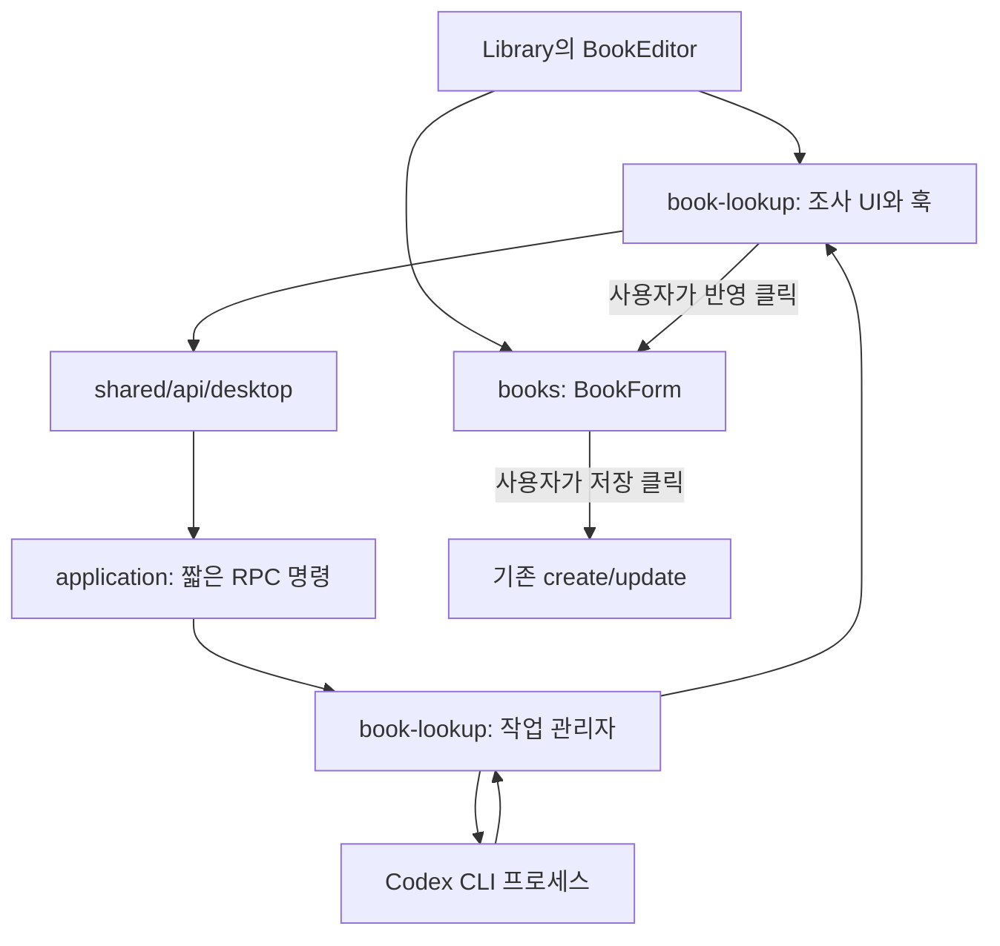

# Codex CLI 기반 도서 조사 도우미 설계·구현 계획

작성일: 2026-10-28 · 상태: 구현 완료 · 자동 테스트 및 네이티브 실조회 확인

이 문서는 [조사 보고서](isbn-autofill-review.md)에 이어 사용자가 정정한 제품 의도를 구체화한다. 구현 기준은 이 문서이며, Codex CLI만 지원 대상으로 삼는다.

## 1. 제품 정의와 범위

**ISBN으로 도서 정보를 조사해 “이런 정보를 찾았는데 맞나요?”라고 제안하는 입력 도우미.** 사용자가 `폼에 반영`을 누른 뒤 필요한 항목을 수정하고 직접 저장한다. 정확성을 인증하는 기능이 아니며 검색 결과의 사실 오류는 있을 수 있다.

첫 버전의 결정 사항:

- 기존 도서 추가·수정 패널 모두에서 사용한다.
- 입력은 ISBN 하나, 실행은 사용자의 `정보 찾기` 클릭이다. 타이핑 중 자동 검색하지 않는다.
- Codex가 찾은 제목·저자·출판사·출간일, 표지 이미지 후보와 출처를 추천한다. 최대 3개 후보를 받되 기본 화면에는 선택한 후보 하나를 표시한다.
- 사용자가 반영할 항목을 선택할 수 있고, 반영 뒤에는 기존 폼에서 자유롭게 수정한다.
- 조사 결과 수신과 폼 반영은 DB를 변경하지 않는다. 기존 저장 경로를 그대로 사용한다.
- 다른 CLI, 도서 API 연동, 채팅 UI, 대량 등록, 이미지 생성·보정, 가격·구매내역 추정, 검색 이력 보관은 첫 버전에서 제외한다.
- 사이트별 본문 재수집, 사실 검증 엔진, 신뢰도 점수, `검증 완료` 표시는 만들지 않는다.

## 2. 화면 설계

### 도서 추가·수정 패널

`.impeccable.md`의 차분하고 실용적인 도구형 화면과 기존 디자인 토큰을 유지한다. 별도 창이나 중첩 모달 없이 폼 안에 도우미를 삽입한다. 기존 폼의 ISBN 입력 행을 도우미의 진입점으로 사용한다.

```text
도서 추가 / 도서 수정

ISBN  [978…                          ] [정보 찾기]

┌ 조회 후에만 표시 ─────────────────────────────┐
│ 이런 도서 정보를 찾았습니다.                  │
│ 후보 [제목 · 출판사                 ▾]        │ ← 후보가 여러 개일 때만
│                                              │
│ ☑ 표지      [수집한 표지 미리보기]            │
│ ☑ 도서명    조사한 제목                       │
│ ☑ 저자      조사한 저자                       │
│ ☐ 출판사    현재 값 → 조사한 출판사           │ ← 기존 값이 다르면 기본 해제
│ ☑ 출간일    YYYY-MM-DD                        │
│ 출처: 출판사 · 서점                           │
│ 참고: 개정판 여부를 확인해주세요.             │ ← 실제 주의사항이 있을 때만
│                         [닫기] [폼에 반영]    │
└──────────────────────────────────────────────┘

도서명 [                                     ]
저자   [                 ] 출판사 [           ]
출간일 [YYYY-MM-DD                           ]
…기존 표지·주제·구매 정보·메모…

                             [취소] [저장]
```

위 배치는 개념 와이어프레임이다. 추천 영역은 얇은 구분선과 기존 공용 UI로 구성하며 별도 장식 카드를 중첩하지 않는다. 좁은 패널에서는 버튼·변경 전후 값·출처를 줄바꿈한다. 폼과 추천 영역이 같은 패널의 스크롤을 사용한다.

현재 `BookForm`은 `publication_date`를 기본값과 스키마에 갖고 있지만 실제 입력 컨트롤은 없다. **출간일 입력을 기본 정보 영역에 추가**해 추천 값을 사용자가 직접 고칠 수 있게 한다. ISBN 라벨은 `ISBN`으로 바꾸고 조회 시 10자리도 허용하되, 폼 반영 시 13자리로 정규화한다. 기존 도서 저장 전체에 새로운 체크섬 제한을 소급 적용하지 않는다.

### 상태별 표시

| 상태 | 표시와 행동 |
| --- | --- |
| 미연결 | `Codex 연결이 필요합니다.`와 설정 안내. 수동 입력은 계속 가능 |
| 대기 | ISBN 입력과 `정보 찾기`만 표시 |
| 조사 중 | `도서 정보를 찾고 있습니다…`와 `취소`; 폼 편집은 가능 |
| 결과 있음 | 후보·필드·출처·참고사항과 `폼에 반영` |
| 결과 없음 | `도서 정보를 찾지 못했습니다.`와 `다시 찾기`; 폼 유지 |
| 실패 | 원인별 짧은 안내와 수동 재시도. 상세 진단은 필요할 때 펼침 |
| 반영 완료 | 결과 영역을 접고 `4개 항목을 반영했습니다. 수정 후 저장해주세요.` 표시 |

퍼센트 진행률이나 가짜 단계 진행은 표시하지 않는다. 결과 수신만으로 포커스를 옮기지 않고 `aria-live="polite"`로 알린다. 반영 후에는 완료 안내를 표시하며 기존 폼에서 계속 수정한다. 조사 취소와 패널 닫기는 별도 버튼이며, 기존 패널의 Escape·포커스 복원 동작을 유지한다.

### 표지 수집과 선택

Codex는 실제 페이지에서 찾은 표지 이미지 URL과 출처 페이지 URL을 반환한다. URL을 추측하거나 이미지를 생성하도록 요청하지 않는다. 도서 후보당 표지 후보는 최대 3개로 제한한다.

선택한 도서 후보의 첫 표지를 앱이 내려받아 최적화한 뒤 추천 영역에 미리 보여준다. 다른 표지 후보는 선택할 때 가져온다. 이 과정은 조사 결과 미리보기이며 폼의 표지를 바꾸지 않는다. 표지가 없으면 표지 항목을 생략하고 텍스트 결과는 그대로 제공한다.

- 기존 표지가 없으면 준비된 표지의 반영 체크를 기본 선택한다. 기존 표지 또는 사용자가 첨부한 이미지가 있으면 기본 해제하고 현재·추천 이미지를 비교해 보여준다.
- 다운로드·최적화 중에는 표지 항목만 선택 불가다. 텍스트만 먼저 반영할 수 있으며, 늦게 준비된 표지를 자동 반영하지 않는다.
- `폼에 반영`을 누르면 선택한 표지만 폼의 로컬 미리보기에 들어간다. 이후 기존 `이미지 변경`·`이미지 삭제`로 교체·제거하고 직접 저장한다.
- 미리보기 준비 중 사용자가 파일을 첨부하거나 표지를 삭제하면 편집 버전을 갱신하고 추천 표지 선택을 해제한다. 늦게 끝난 이미지 처리가 수동 선택을 덮어쓰지 않는다.
- 실패 시 `표지를 가져오지 못했습니다.`와 재시도·다른 후보 선택을 제공한다. 텍스트 추천과 수동 파일 첨부는 계속 사용할 수 있다.

### 설정

설정 페이지에 `도서 조사 도우미` 섹션을 추가한다.

- 공급자는 `Codex CLI`로 고정한다. 공급자 선택 UI는 없다.
- AI 모델·추론 수준: 기본 `gpt-6.1-terra` / `medium`. 다른 모델 ID도 직접 입력할 수 있으며 지원 여부는 실제 CLI 연결에서 확인한다.
- 실행 파일 경로: 탐지한 절대 경로를 제안하고 직접 수정할 수 있게 한다. 셸 시작 스크립트를 실행해 경로를 찾지 않는다.
- `실행 확인`: 실행 파일·버전·필수 옵션 지원 여부를 확인한다. 이 검사만으로 로그인이나 웹검색 성공을 표시하지 않는다.
- `검색 연결 테스트`: 공개 ISBN 하나로 사용자가 직접 실행한다. 모델 호출과 사용량이 발생한다는 안내를 붙인다. 성공하면 해당 시점의 검색 연결 성공을 표시한다.
- `Codex CLI에서 로그인한 계정을 사용합니다. 검색 요청은 외부 서비스로 전송되며 Codex 사용량에 반영됩니다.`라는 짧은 설명을 둔다.
- 로그인은 사용자가 터미널에서 수행한다. 앱이 인증 토큰을 읽거나 로그인 화면을 자동 실행하지 않는다.

실행 경로·모델 ID·추론 수준을 기기별 설정 파일에 저장한다. 도서 DB·백업에 포함하지 않고, 도서 데이터 초기화와는 독립적으로 유지한다. 토큰·검색 결과·연결 테스트의 ISBN은 설정 파일에 저장하지 않는다.

## 3. 폼 반영 규칙

| 조건 | 기본 선택·처리 |
| --- | --- |
| 현재 값이 비어 있고 추천 값이 있음 | 선택 |
| 현재 값과 추천 값이 같음 | `같음` 표시, 변경 대상에서 제외 |
| 현재 값이 있고 추천 값이 다름 | 현재 값과 추천 값을 표시하고 기본 선택 해제 |
| 추천 값이 없거나 날짜 형식이 잘못됨 | 선택 불가. 기존 값을 지우지 않음 |
| 조사 도중 또는 결과 표시 후 사용자가 필드를 수정함 | 해당 항목 선택을 해제하고 최신 현재 값으로 차이를 갱신 |
| ISBN을 변경함 | 진행 작업 취소·추천 결과 무효화. 이전 ISBN 결과를 반영하지 않음 |
| 후보를 바꿈 | 현재 폼 기준으로 항목 선택을 다시 계산 |

추천 제목·저자·출판사·출간일만 패치한다. ISBN10→13 변경은 반영 버튼을 누를 때 함께 표시·적용한다. 후보가 보고한 ISBN이 요청과 다르면 눈에 띄는 참고 문구를 보여주고 기본 선택을 모두 해제한다. 사용자가 직접 확인해 항목을 선택할 수 있으며, 다른 ISBN으로 몰래 바꾸지 않는다.

`폼에 반영` 처리 직전에도 현재 ISBN과 필드별 편집 버전을 확인한다. 화면에서 확인한 뒤 변경된 필드는 건너뛰고 그 사실을 알려준다. 적용에는 `setValue(..., { shouldDirty: true, shouldValidate: true })`를 사용하고 폼 전체 `reset`은 사용하지 않는다. 표지는 사용자가 선택한 경우에만 교체하며, 구매 정보·메모는 그대로 유지한다.

반영 후 다시 수정할 수 있다는 것이 기본 복구 수단이다. 별도 다단계 되돌리기 기능은 첫 버전에 넣지 않는다. 결과 영역의 `닫기`는 추천만 닫고 폼을 바꾸지 않는다.

### 이미 등록된 책의 확인 스낵바

동일 도서는 체크섬이 유효한 ISBN10/13을 ISBN13으로 정규화해 비교한다. 제목만 같은 다른 판본을 같은 책으로 단정하지 않는다. 수정 중인 도서 자신은 제외하고, 현재 화면에 로드된 목록뿐 아니라 저장소 전체에서 조회한다.

`정보 찾기`를 누르거나 폼을 저장할 때 동일 ISBN이 있으면 자동으로 사라지지 않는 스낵바를 표시한다: **“동일한 책이 이미 N권 존재합니다. «제목» 그래도 입력하시겠습니까?”** 버튼은 `취소`와 `계속 입력`이다. 닫기·취소·패널 종료는 모두 진행 거부로 처리한다. 같은 폼 세션에서 같은 ISBN·같은 기존 도서 목록에 이미 동의했다면 저장 시 다시 묻지 않는다. 중복 구매 표시 필드는 임의로 변경하지 않는다.

## 4. 모듈과 상태 소유권



- `BookForm`이 입력값·필드별 수정 버전·반영 처리를 소유한다.
- 새 페이지 컴포넌트 `BookEditor`가 `BookForm`과 조사 기능을 조합한다. 추가·수정 패널 모두 이를 사용한다.
- `BookForm`에 `renderIsbnHelper(context)` 같은 렌더 슬롯을 둔다. context는 현재 ISBN·서지 필드·표지 상태·편집 버전과 `applySuggestion` 콜백만 제공한다. React Hook Form 인스턴스 전체를 외부에 노출하지 않는다.
- `BookEditor`가 슬롯 안에 `BookLookup`을 렌더링한다. `books`와 `book-lookup` 간 직접 import는 없다.
- 폼 세션마다 새 식별자를 만든다. 패널 닫기·다른 도서 편집·잠금 후 재진입에서는 이전 결과를 재사용하지 않는다.
- 조사 훅이 실행·상태 폴링·선택 후보를 소유하고 언마운트 시 폴링 중단과 작업 취소를 요청한다.
- 데스크탑 작업 관리자는 DB나 복호화 키에 대한 참조를 받지 않는다.

예정 파일과 책임:

| 경로 | 작업 |
| --- | --- |
| `contracts/book-lookup.ts` | 추천 타입, 필드 패치, 작업 상태·오류 코드 |
| `contracts/desktop.ts` | 조회·취소·Codex 설정 명령 추가 |
| `src/features/book-lookup/` | `BookLookup`, `CodexSettings`, 작업 훅, 결과·선택 모델과 공개 API |
| `src/features/books/components/BookForm.tsx` | ISBN 슬롯, 출간일 입력, 선택 패치 적용 |
| `src/pages/library/components/BookEditor.tsx` | 두 기능 조합과 폼 세션 수명 |
| `src/pages/library/Library.tsx` | 추가·수정 패널에서 `BookEditor` 사용 |
| `src/pages/settings/Settings.tsx` | Codex 설정 공개 컴포넌트 배치 |
| `desktop/book-lookup/` | ISBN 검사, 작업 관리자, Codex 실행·출력 파싱, 표지 다운로드, 프롬프트·스키마 |
| `src/shared/lib/` | 두 기능이 함께 사용하는 이미지 최적화 처리; 기존 구현을 이동·재사용 |
| `src/features/books/components/CoverAttachment.tsx` | 외부 추천과 수동 첨부가 같은 폼 표지 상태를 사용하도록 조정 |
| `desktop/platform/` | 기기별 Codex 설정 파일, 외부 출처 열기 어댑터 |
| `desktop/application/command-service.ts` | 잠금 검사, 짧은 작업 명령, 무효화 연결 |
| `desktop/index.ts`, `desktop/dev-server.ts` | 의존성 주입·프로세스 종료 처리 |
| `tooling/checks/architecture.mjs` | 새 모듈 경계 명시 |

`application → book-lookup`을 허용하고 `book-lookup → library/storage/security/src`는 금지한다. 플랫폼 설정·링크 열기는 진입점에서 어댑터로 주입한다. 테스트를 위한 가짜 실행기도 같은 계약으로 주입하며 제품 UI에 테스트 옵션을 노출하지 않는다.

## 5. 결과 계약과 RPC

Codex 출력은 작게 고정한다. 다음은 계약 초안이며 TypeScript 구현은 아직 없다.

```ts
type LookupResult = {
  candidates: Array<{
    title: string;
    author: string | null;
    publisher: string | null;
    publicationDate: string | null;
    reportedIsbn: string | null;
    sources: Array<{ label: string; url: string }>;
    covers: Array<{ imageUrl: string; sourcePageUrl: string }>;
    notes: string[];
  }>;
};
```

JSON Schema는 모든 키를 명시하고 `additionalProperties: false`를 쓴다. 응답은 앱에서도 런타임 검사한다. 후보 최대 3개, 후보당 출처 최대 5개·참고사항 최대 3개, 최종 응답 64KiB 등 유한한 상한을 둔다. 제목은 기존 폼의 500자 제한에 맞춘다. 출처나 참고사항이 없으면 빈 배열이며, 소스가 없다는 이유만으로 도서 정보를 정답으로 간주하거나 전체 결과를 버리지 않는다.

유효한 JSON에서 잘못된 날짜·URL은 해당 필드만 제외하고 참고사항을 붙인다. 계약 자체가 깨진 출력은 실패 처리한다. 유효한 빈 후보 배열은 `not_found`다. 출처는 HTTP(S) 링크만 허용하고 텍스트로 렌더링한다. 기존 네이티브 창은 `views://main/*`만 허용하므로 출처는 운영체제 기본 브라우저로 여는 어댑터를 추가한다. 웹뷰 내부 이동은 하지 않는다.

| 명령 | 입력 → 결과 |
| --- | --- |
| `lookupStart` | `{ requestId, isbn }` → `{ jobId }` |
| `lookupStatus` | `{ jobId }` → 상태 + 완료 결과 또는 오류 코드 |
| `lookupCoverStart` | `{ jobId, candidateIndex, coverIndex }` → `{ transferId }`; 앱이 보관한 후보 URL만 사용 |
| `lookupCoverStatus/Cancel` | `{ transferId }` → 다운로드 상태·완료 바이트 또는 취소; 이미지 바이트는 한 번 수신 후 메모리에서 재사용 |
| `lookupCancel` | `{ jobId }` → 취소 상태; 반복 호출 가능 |
| `codexSettingsGet/Set` | 실행 경로 조회·저장; 일반 폼 입력으로 임의 명령을 받지 않음 |
| `codexProbe` | 버전·옵션 검사 작업 시작 → `{ jobId }`; 모델 호출 없음 |
| `openLookupSource` | `{ jobId, candidateIndex, sourceIndex }` → 외부 브라우저 열기 |

연결 테스트도 같은 `lookupStart` 작업 경로를 쓴다. 별도의 무제한 실행 명령은 만들지 않는다. 상태 폴링은 활성 작업 동안 약 1초 간격으로 시작하고 종료·언마운트에서 멈춘다. 네트워크 전달 오류 때 같은 `requestId`를 재사용하면 기존 작업을 반환해 중복 실행을 방지한다.

오류는 `CLI_NOT_FOUND`, `CLI_UNSUPPORTED`, `AUTH_REQUIRED`, `RATE_LIMITED`, `TIMEOUT`, `INVALID_OUTPUT`, `PROCESS_FAILED`, `BUSY` 등으로 구분한다. Codex 출력에서 원인을 확실히 식별하지 못하면 `PROCESS_FAILED`로 처리하고 추측해 인증 오류라고 단정하지 않는다. 작업 오류는 명령 전송 실패와 구분하여 상태 응답 안에 코드로 반환한다.

## 6. Codex 실행과 작업 수명

기존 조사에서 로컬 `codex-cli 0.164.0`의 `exec`, 실시간 검색, 구조화 출력 옵션을 확인했다. [비대화형 실행 문서](https://learn.chatgpt.com/docs/non-interactive-mode)와 [웹검색 문서](https://learn.chatgpt.com/docs/web-search)를 참조하되, 구현 시작 시 설치 버전에서 다시 확인한다. 미실행 조합을 지원 완료로 취급하지 않는다.

실행안은 고정 인자 배열로 다음 옵션을 사용하는 것이다.

```text
codex --search -a never exec
  --sandbox read-only --ephemeral --skip-git-repo-check
  --ignore-user-config --cd <작업별 임시 폴더>
  --output-schema <스키마 파일> --json --color never
  -o <최종 결과 파일> -
```

프롬프트는 stdin으로 보낸다. 폴더·파일은 앱이 준비하고 정리한다. 기본 모델은 `gpt-6.1-terra`, 추론 수준은 `medium`으로 둔다. 설정에서 모델 ID와 추론 수준(`low`, `medium`, `high`, `xhigh`, `max`)을 변경하며, 실행마다 `-m`과 `-c model_reasoning_effort`로 명시한다. 사용자 전역 Codex 설정은 수정하지 않는다. 지원되지 않는 조합은 오류로 안내하며 다른 모델로 자동 전환하지 않는다. 사용자 설정을 무시한 실행이 현재 인증과 호환되는지는 첫 기술 검증에서 확인한다. 이 조합이 지원되지 않는다고 전체 권한 옵션으로 대체하지 않는다.

프롬프트에는 ISBN과 다음 작업만 담는다: 한국·일본 도서 웹검색, 발견한 정보·표지 이미지 URL·출처 페이지 제시, 다른 판본 가능성 안내, 불명확한 값은 null, 결과가 없으면 빈 배열, 파일·코드 수정 금지. 검색은 도구를 실제 사용하도록 요청하고 관찰 가능한 검색 이벤트가 없다면 그 한계를 알린다. 검색 이벤트 자체도 내용의 사실성 증명으로 쓰지 않는다.

- 동시 작업은 1개. 두 번째 새 요청은 `BUSY`; 이전 작업 취소 후 재시도할 수 있다.
- 전체 제한은 90초, 버전 검사 5초. 모델 호출의 자동 재시도는 하지 않고 사용자가 `다시 찾기`를 누르게 한다. 이전 보고서의 자동 재시도 제안은 이 결정으로 대체한다.
- stdout/stderr는 계속 소비하되 총량·단일 이벤트 크기에 상한을 두고 초과 시 작업을 종료한다. 원시 이벤트와 전체 stderr는 영구 저장하지 않는다.
- `lookupStart`는 작업을 예약하고 즉시 끝낸다. CLI 종료를 기존 직렬 명령 큐 안에서 기다리지 않는다. `codexProbe`도 같은 방식으로 처리한다.
- 잠금·초기화·복원·정상 앱 종료에서 현재 작업을 무효화하고 자식 프로세스를 종료한다. 취소 완료 뒤 늦게 도착한 결과는 버린다.
- 취소 시 실행한 자식과 그 자손만 종료한다. 짧은 종료 유예 후 강제 종료하고 실제 종료를 확인한다. 사용자의 다른 Codex 프로세스에는 접근하지 않는다.
- 완료 결과와 다운로드한 표지 원본은 메모리에 최대 10분 보관 후 제거한다. 패널을 닫으면 즉시 폐기하며, 만료 후 출처 열기는 재조사를 안내한다. 영구 캐시는 없다.

일반 종료 처리는 비동기 정리가 가능한 수명 이벤트에서 수행한다. 현재 `process.on('exit')`에 비동기 취소를 추가하는 것만으로 완료했다고 판단하지 않는다. 개발 서버의 SIGTERM도 동일하게 정리한다. 앱 강제 종료·크래시 때 자식이 남는지는 기술 검증 항목으로 남기고, 필요하면 부모 종료 감시를 추가한다.

CLI는 검색 도구만 필요하므로 개인 MCP·훅·추가 실행 도구의 유입을 최소화한다. `read-only`와 임시 작업 폴더는 홈 디렉터리 읽기를 차단한다는 보장이 아니다. 실제 버전의 도구 제한 수단을 기술 검증에서 확인하고 제한 범위를 문서화한다. 앱은 도서 데이터나 키를 프롬프트·환경 변수로 전달하지 않는다. 이 실행 범위 점검은 서지 정확성을 보장하기 위한 검증과는 별개다.

### 표지 데이터 처리

외부 URL을 WebView의 ``에 직접 넣지 않는다. `desktop/book-lookup`의 전용 다운로드 작업이 바이트를 가져오고, 렌더러는 이를 로컬 Blob으로 처리한다. CLI에는 다운로드·파일 저장을 맡기지 않는다. 사용자 확인은 이미지 내용과 판본 판단이며, 앱 검사는 파일을 안전하게 처리하기 위한 기술 검사다.

1. 앱이 보관한 후보의 공개 HTTP(S) URL만 받는다. 로컬 파일·내부망·루프백 주소는 차단하고 리다이렉트마다 주소와 실제 접속 대상을 검사한다. 호스트 검사 후 다른 주소로 연결되는 우회도 막는다. 최대 리다이렉트 3회, 다운로드 15초, 원본 20MiB 제한을 적용한다. Content-Length만 믿지 않고 수신량도 제한한다.
2. 쿠키·CLI 인증 정보는 전송하지 않는다. 403·접근 제한·로그인 요구를 만나면 실패 처리한다. 출처 페이지와 이미지 URL을 구분해 보관한다.
3. JPEG·PNG·WebP의 실제 파일 형식을 검사하고 HTML·SVG 등은 거부한다. 원본 바이트는 JSON 브리지에 맞는 제한된 전송 계약으로 전달한다. 기존 `CoverUpload`는 최적화 후 JPEG/WebP 전용이므로 원본 PNG 전송에 억지로 재사용하지 않는다.
4. 기존 `optimizeCover`의 이미지 디코딩·4천만 화소 제한·축소·재인코딩 처리를 재사용한다. `book-lookup`이 `books` 내부를 import하지 않도록 공용 이미지 처리 부분을 `shared/lib`로 이동하고 기존 첨부에서도 같은 함수를 사용한다. 실패한 디코딩도 표지 항목의 실패로 처리한다.
5. 기존 계약에 따라 최대 640×800px, 128KiB의 JPEG/WebP `CoverUpload`로 변환한다. 미리보기는 로컬 Blob URL을 사용하고 교체·닫기 때 해제한다. 이미지 비율은 유지하며 자르기·AI 보정은 하지 않는다.
6. 추천과 폼의 표지 상태는 분리한다. `CoverAttachment`는 추천 표지를 전달받아 기존 첨부 선택 상태에 반영하고, 파일 변경·삭제 및 편집 버전을 폼에 전달한다. `undefined`는 기존 표지 유지, `null`은 삭제, 이미지 객체는 새 표지라는 의미를 유지한다.
7. 사용자가 저장할 때 기존 `cover` 업로드 경로로 암호화 보관한다. 외부 URL을 `Book.image_url`에 저장하지 않으며, 저장 전에는 영구 표지 파일을 만들지 않는다. 기존 백업의 로컬 표지 포함 동작을 재사용한다.

표지 전송은 Codex 조사 프로세스와 별도 수명을 갖되 부모 조사 세션에 종속된다. 동시에 1개만 다운로드하고, 후보 변경·패널 닫기·잠금·초기화·복원 시 취소한다. 늦은 다운로드·최적화 결과는 세션과 표지 편집 버전이 다르면 버린다. URL이 공개되어 있다는 사실만으로 재사용 허용을 단정하지 않으며, 출처를 남기고 접근 제한을 우회하지 않는다.

## 7. 구현 순서와 완료 기준

각 단계는 앞 단계의 결과를 사용한다. 구현은 아래 순서로 진행하며 검증 기록은 문서 끝에 남긴다.

| 단계 | 작업·산출물 | 완료 기준 |
| --- | --- | --- |
| 1. Codex 실행 검증 | 임시 폴더에서 공개 ISBN·표지 URL 조사, 스키마 출력, 인증 실패, 취소, 기본 설정 격리 확인 | 실제 검색·최종 JSON을 받고 앱 프로세스에서 실행 가능한 인자 조합 확정. 로그인·권한·종료의 미해결점 기록 |
| 2. 계약·작업 관리자 | 계약, ISBN 검사, Codex runner, 상태·시간 제한·출력 상한, 기기 설정, 표지 다운로드·제한 | 가짜 프로세스로 성공/실패/시간 초과/취소/중복 요청 검증. 긴 작업 중 기존 명령이 응답함 |
| 3. 도우미와 폼 조합 | 설정, ISBN 슬롯, 추천 결과, 선택 반영, 출간일 입력, 표지 미리보기·선택·교체, 외부 출처 열기 | 결과만 도착했을 때 폼 불변. 반영 후 부분 수정 가능. 저장 전 DB 불변 |
| 4. 수명·회귀 검증 | 잠금·복원·초기화·패널 닫기·앱 종료, 수동 편집 경쟁 처리 | 늦은 결과·다른 도서의 결과가 폼을 바꾸지 않음. 관련 자식 프로세스 정리 |
| 5. 실제 사용 평가 | 한국·일본 각 5권으로 실제 조회·표지 수집·반영·수정·저장, 네이티브 패키지 확인 | 검색·수정 수고와 대기 시간을 기록하고 사용성 문제 수정. 모델의 사실 오류 0건을 출시 조건으로 삼지 않음 |

단계 1이 실패하면 UI를 만들어 두고 “연결 완료”라고 보고하지 않는다. 실패한 조건을 먼저 해결하거나 지원 범위를 좁힌다. 각 5권 평가는 작은 사용성 확인이며, 보고서의 40권 API 비교는 선택적 후속 조사로 돌린다. API와의 우열 입증을 이 기능의 선행 조건으로 두지 않는다.

### 검증할 핵심 시나리오

- 결과 도착·추천 닫기·실패·취소로 기존 입력값이 바뀌지 않는다.
- 선택한 항목만 들어가고 미선택 항목·미선택 표지·구매 정보는 유지된다.
- 반영 후 사용자가 저자·출간일을 수정하고 저장하면 수정값이 저장된다.
- 조사 중 입력 변경, 결과 표시 후 변경, ISBN 변경, 패널 닫고 다른 도서 열기를 처리한다.
- 미로그인·한도·시간 초과·잘못된 JSON은 수동 입력을 막지 않는다.
- 잠금·초기화·복원 후 이전 결과를 가져오거나 출처를 열 수 없다.
- 한글·일본어·긴 제목·날짜 일부 누락·빈 출처·다중 후보가 UI를 깨뜨리지 않는다.
- 표지 없음·다운로드 실패·다른 표지 후보·표지 교체·삭제·기존 표지 유지가 가능하며, 텍스트만 반영해도 동작한다.
- HTML 위장 이미지·초과 용량·내부망 URL·리다이렉트 우회·느린 다운로드를 거부하고, 취소 후 늦은 표지 결과를 버린다.
- 표지 포함 저장 후 재실행·백업·복원에서 로컬 이미지가 유지된다.
- 키보드만으로 후보 선택·반영·수정·저장을 수행할 수 있다.

자동 테스트는 가짜 CLI 실행기를 주입해 결정적으로 수행한다. 실제 계정 호출은 별도 수동 네이티브 검증으로 구분하며 CI에서 사용자 구독을 소모하지 않는다. 기존 명령에 시나리오·파일 경로를 넘기고 새 테스트 별칭은 만들지 않는다.

구현 후에는 `nvm use`로 버전을 맞추고 `pnpm check`, 관련 프런트엔드·데스크탑 테스트, 해당 E2E를 실행한다. 최종 통합 시 전체 테스트와 `pnpm build`를 수행하고 생성된 렌더러와 패키지 내부 렌더러 일치를 확인한다. 실제 패키지에서 CLI 경로·검색·취소·출처 브라우저 열기를 확인한다. 브라우저 E2E 통과와 네이티브 성공은 따로 기록한다.

## 8. 최종 수용 기준

사용자는 ISBN을 넣고 조사 결과를 읽은 뒤 선택해 폼에 반영할 수 있다. 반영한 모든 서지 필드는 직접 수정할 수 있고 표지는 파일로 교체하거나 제거할 수 있으며, 저장 전에는 영속 데이터가 바뀌지 않는다. 도우미를 설정하지 않았거나 조사에 실패해도 기존 수동 등록·수정은 계속 사용할 수 있다. 도우미의 가치는 정답 보장이 아니라 검색·복사·입력의 수고를 줄이는 데 있다.

## 구현 검증 기록

- 기본 모델 `gpt-6.1-terra`, 추론 `medium`으로 실제 Codex 검색을 실행해 구조화된 서지·출처·표지 후보와 검색 이벤트를 받았다. 표지 후보 JPEG 다운로드도 확인했다. 이는 그 도서 정보의 사실 정확성을 보증하지 않는다.
- `pnpm check` 통과. 프런트엔드 테스트 105개, 데스크탑 테스트 35개 통과.
- 브라우저 E2E 전체 실행에서 9개 통과 후, 설정 화면 길이에 의존하던 라이선스 모달 테스트의 배경 스크롤 비교를 수정하여 해당 1개 재실행도 통과했다. 도우미 E2E는 설정 저장, 중복 취소/계속, 표지 포함 선택 반영, 수정·저장·재조회까지 검증한다. CLI 응답은 E2E에서 모의 응답을 사용한다.
- 렌더러 빌드와 네이티브 개발 패키징 완료. 패키지 내부 렌더러가 생성된 렌더러와 일치함을 빌드 검사로 확인했다.
- 사용자 서재와 분리한 임시 데이터 폴더의 네이티브 앱에서 Codex 0.164.0 실행 확인, 실제 ISBN `9788966260959` 검색, 표지 미리보기, 명시적 폼 반영, 제목 수정 및 저장을 확인했다. 같은 ISBN 재입력 시 중복 스낵바와 취소 동작도 확인했다.
- 검증 범위: 한국어 도서 1권의 실제 검색을 확인했다. 한국·일본 각 5권의 사용성 평가는 후속 평가로 남는다. 실제 네이티브에서 인증 실패·강제 종료·외부 브라우저 출처 열기·표지 백업 복원 전체 조합을 검증한 것은 아니다.
- 버전 확인은 최대 5초의 짧은 명령이며 검색 작업은 저장소 명령 큐 밖에서 실행한다. 구조화 오류는 현재 사용자용 메시지로 구분한다.
- 기기 설정은 앱 데이터 폴더의 `codex-settings.json`이며 백업 대상이 아니다. 모델 호출에 인증 토큰·개인 서재 데이터를 전달하지 않는다.
- 알려진 실행 경계: `read-only`는 홈 디렉터리 읽기 자체를 차단하지 않는다. 기본 사용자 설정 로드를 끄고 shell·multi-agent 기능을 비활성화한 상태로 실제 호출을 확인했으며 OS 수준의 완전한 격리를 주장하지 않는다.

